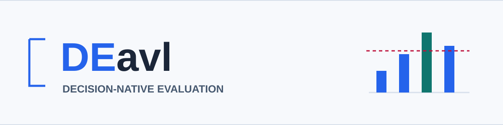

<p align="center">
  <picture>
    <source media="(prefers-color-scheme: dark)" srcset="docs/assets/hero-dark.svg">
    
  </picture>
</p>

<h1 align="center">Decision-model evaluation for AI applications</h1>

<p align="center">
  <strong>Write the rubric once. Choose the decision model in config.</strong><br>
  Turn bounded questions into explicit scores, then benchmark the judge itself.
</p>

<p align="center">
  <a href="https://github.com/aigauravsingh-star/DEval/actions/workflows/ci.yml"></a>
  <a href="pyproject.toml"></a>
  <a href="LICENSE"></a>
  <a href="pyproject.toml"></a>
  <a href="#faq"></a>
</p>

<p align="center">
  <a href="#quickstart"><strong>Quickstart</strong></a> &middot;
  <a href="#what-can-you-evaluate">Features</a> &middot;
  <a href="docs/providers.md">Providers</a> &middot;
  <a href="#use-your-existing-evaluation-framework">Integrations</a> &middot;
  <a href="docs/scoring.md">Scoring</a> &middot;
  <a href="#faq">FAQ</a> &middot;
  <a href="CONTRIBUTING.md">Contribute</a>
</p>

---

**DEavl separates semantic judgment from scoring.** A decision model answers
questions about your application's output. DEavl validates the probability
distributions, applies your rubric, and records a report you can inspect and compare.

Use **Jev, self-hosted Kev, Microsoft Foundry, or a compatible System One server**
through configuration. Run standalone, or bring the provider into DeepEval and
Ragas with optional adapters. The core has no runtime dependencies and does not
depend on JevRails.

> [!NOTE]
> This repository is named **DEval**; the library, Python import, and CLI are
> **DEavl**, `deavl`, and `deavl`. Install from source using the quickstart below.

## What Can You Evaluate?

| Your Goal | What DEavl Provides |
| --- | --- |
| **Check RAG answers** | Questions about holistic groundedness, relevance, and instruction adherence |
| **Assess tool use** | Rubrics about grounding in tool results and authorized operations |
| **Encode your own criteria** | Yes/no (Noul), categorical Choice, and ordered Score questions |
| **Apply release criteria** | Weighted scores, per-metric thresholds, required gates, and N/A handling |
| **Evaluate the judge** | Independent-label accuracy, false passes/failures, Brier score, log loss, and calibration bins |
| **Compare changes** | Saved-run comparisons with matching data, rubric, and preparation identities |

Every case sends its rubric questions together in **one decision request**.
Reports include distributions, versioned identities, latency, token usage when
available, and inference cost only when token counts and explicit rates are supplied.

## Quickstart

### 1. Install and Try Without a Key

Requires **Python 3.10+**:

```bash
git clone https://github.com/aigauravsingh-star/DEval.git
cd DEval
python -m pip install -e .
python examples/offline_eval.py
```

The demo uses fixed fixture answers so you can inspect the report. It is **not
inference**, a model-quality benchmark, or evidence of cost savings. Live-provider
errors never fall back to fixtures. This is a source release, not a PyPI release.

### 2. Run a Real Evaluation

Start a local Kev server first, then run:

```bash
deavl run examples/cases.jsonl \
  --rubric examples/rubric.json \
  --config examples/providers/kev.json \
  --output kev-report.json --benchmark
```

For Jev, set `JEV_API_KEY` in your process environment and change only the config
path to `examples/providers/jev.json`. [Choose and configure a provider](docs/providers.md)
before sending data. The bundled dataset contains two illustrative labeled cases,
not a representative benchmark.

**You get:** a JSON run report with scores, decisions, and provenance, plus an
independent-label statistics file when `--benchmark` is enabled. Exit **0** means
all cases passed, **2** means a case failed/skipped, and **1** means an execution
or configuration error.

### 3. Define Your Own Rubric in Python

```python
from deavl import EvalCase, Evaluator, Metric, Question, Rubric, load_backend

rubric = Rubric("support", version="1", metrics=(
    Metric(
        Question("grounded", "Is every fact in state.response supported by state.context?"),
        threshold=0.8,
        required=True,
    ),
    Metric(Question("relevant", "Does state.response answer state.input?")),
))
cases = [EvalCase("opening-hours", {
    "input": "When does the shop open?",
    "response": "At 9am.",
    "context": ["The shop opens at 9am."],
})]

# Requires a running local Kev server.
backend = load_backend({"provider": "kev"})
report = Evaluator(backend).evaluate(cases, rubric)
print(report.summary)
```

The model judges the two questions. DEavl computes their scores. A required
metric must pass independently of the weighted average. These example thresholds
are starting points, not certified safety settings.

## Change the Provider, Keep the Rubric

| Provider | Configuration | Before You Run |
| --- | --- | --- |
| **Jev** | [jev.json](examples/providers/jev.json) | TypeSafe API key |
| **Kev** | [kev.json](examples/providers/kev.json) | Running self-hosted server |
| **Microsoft Foundry** | [azure.json](examples/providers/azure.json) / [Entra](examples/providers/azure-entra.json) | Resource URL, deployed model, and credentials |
| **Compatible System One** | [systemone.json](examples/providers/systemone.json) | Compatible endpoint and declared capabilities |

Configuration does not deploy a model or make providers equally accurate.
Backends must return native, complete probability distributions for the question
types you use. Arbitrary chat-completions endpoints are not drop-in replacements.
See [provider capabilities, limits, and authentication](docs/providers.md).

## Use Your Existing Evaluation Framework

```bash
python -m pip install -e ".[deepeval,ragas]"
```

| Workflow | Adapter |
| --- | --- |
| DEavl rubric inside DeepEval | `as_deepeval_metric(backend, rubric)` |
| DEavl provider inside native JevEval | `as_deepeval_model(backend)` |
| Custom numeric metric in Ragas | `as_ragas_metric(backend, rubric)` |

Read the [complete framework examples](docs/integrations.md). The Ragas adapter
returns a numeric score, not DEavl's required-gate verdict, and is not the legacy
`ragas.evaluate` interface. Generative extraction and built-in framework metrics
are not automatically replaced by a decision model.

## Benchmark the Judge, Not Just the App

Give your dataset independent labels to measure whether the judge is right:

```bash
deavl benchmark kev-report.json examples/cases.jsonl --output judge-stats.json
deavl compare examples/cases.jsonl kev-report.json jev-report.json --output comparison.json
```

The second command needs reports from both providers on matching data and rubric.
Benchmarks include accuracy, confusion counts, false passes/failures, calibration
statistics, and binary threshold/abstention sweeps. Comparisons report paired score
deltas; score improvement alone is not evidence of better correctness.

See [definitions, missing-data behavior, and cost scope](docs/scoring.md).
Gold labels are separate from evaluation state and are not sent by default.

## Documentation

| Guide | What You Will Find |
| --- | --- |
| [Providers](docs/providers.md) | Hosted/local setup, environment variables, authentication, and capabilities |
| [Scoring and benchmarks](docs/scoring.md) | Score math, required gates, independent labels, and comparisons |
| [Integrations](docs/integrations.md) | DeepEval, native JevEval, Ragas, and custom backend examples |
| [Examples](examples) | Offline demo, live evaluation, JSONL cases, rubrics, and provider configs |
| [Security](SECURITY.md) | Data flow, report sensitivity, and vulnerability reporting |
| [Contributing](CONTRIBUTING.md) | Local checks and useful first contributions |

## FAQ

**Is this a replacement for DeepEval or Ragas?**

No. [DeepEval already offers JevEval](https://deepeval.com/docs/metrics-jev-eval),
and [Ragas supports custom metrics](https://docs.ragas.io/en/stable/references/metrics/).
DEavl complements them with a small portable engine, explicit scoring, provider
configuration, and independent-label judge benchmarks.

**Does it support every model or modality?**

No. This alpha supports text/JSON states and compatible decision backends.
Multimodal inputs and arbitrary chat endpoints need other adapters. Declaring
capabilities is not model certification; a model's stated certainty is not proof
that its probabilities are calibrated.

**Where does my data go?**

The selected backend receives your evaluation state and questions. Self-hosting
can keep inference within your infrastructure. Core DEavl sends no telemetry and
does not upload reports automatically; optional frameworks have their own settings.
Reports omit inputs by default but can still contain sensitive metadata and rubric
text. See [SECURITY.md](SECURITY.md).

**Does a high groundedness score prove my answer is correct?**

No. Holistic groundedness is not claim-level Ragas Faithfulness or fact-checking.
Extraction requires supplied claims or a separately versioned preparation step.
DEavl does not silently generate claims or model-written explanations.

## Contribute

Useful contributions include provider-contract tests, labeled regression cases,
documentation improvements, and focused adapter fixes. See [CONTRIBUTING.md](CONTRIBUTING.md).
Live model quality, hardware support, and performance need separate validation.

Licensed under [Apache 2.0](LICENSE). See [NOTICE](NOTICE). Independent alpha software.
